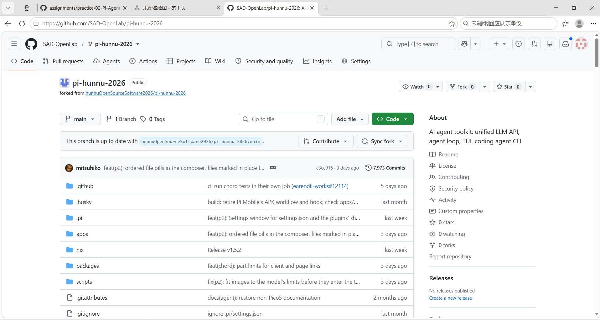
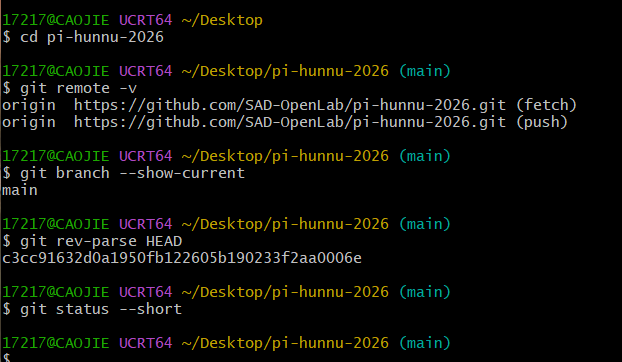
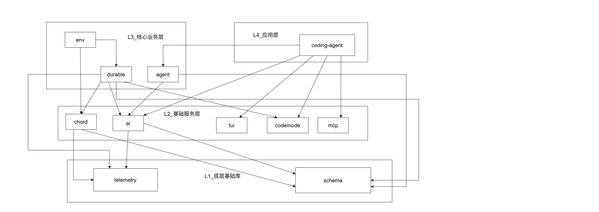

# 实践课2：组织建仓与源码分析报告

## 一、 源码获取

**1. 实际 Clone 地址**：
https://github.com/SAD-OpenLab/pi-hunnu-2026.git

**2. 组织仓库建仓截图**：

**3. 本地源码目录及 Clone 信息截图**：
 

---

## 二、 模块分析

### 1. 模块分析表

| 子文件夹 | 代码主要实现什么功能 | 本模块 build 执行什么、生成什么 | 直接依赖哪些内部模块 | 依据文件或代码位置 |
| :--- | :--- | :--- | :--- | :--- |
| `telemetry` | 提供与供应商无关的遥测契约和类型化 Schema 工具。 | 执行 `tsc` 编译，生成 `dist` 目录及 JS/类型声明文件。 | 无 | `telemetry/package.json` |
| `schema` | 提供不使用 eval 的高性能 JSON Schema 验证功能。 | 执行 `tsc` 编译，生成 `dist` 目录。 | 无 | `schema/README.md` 及 `package.json` |
| `chord` | 跨进程的应用对象运行时。支持对象契约、插件热重载、RPC 通信等。 | 执行 `tsc` 编译，生成 `dist`。 | `schema`, `telemetry` | `chord/README.md` 及 `package.json` |
| `tui` | 终端用户界面库。支持差异化渲染，专为高效文本应用设计。 | 执行 `tsc` 编译；另包含原生扩展构建脚本。 | 无 | `tui/package.json` |
| `codemode` | 沙箱化的 JS 执行环境，唯一能力是调用注入的工具。 | 执行 `tsc` 编译，生成 `dist`。 | 无 | `codemode/package.json` |
| `mcp` | 独立的模型上下文协议（MCP）客户端。 | 执行 `tsc` 编译，生成 `dist`。 | 无 | `mcp/package.json` |
| `ai` | 统一的大模型 API。支持跨厂商调用、流式输出、Token 追踪。 | 先 `generate-models`，再 `tsc` 编译，并复制数据到 `dist`。 | `schema`, `telemetry` | `ai/README.md` 及 `package.json` |
| `durable` | Pi 的持久化对话、任务和文档运行时。 | 执行 `tsc` 编译，生成 `dist`。 | `chord`, `ai`, `codemode`, `schema`, `telemetry` | `durable/package.json` |
| `env` | 远程执行环境（基于 SSH 守护进程及客户端）。 | 执行 `tsc` 编译（另有 Rust 构建脚本）。 | `chord`, `durable` | `env/package.json` |
| `agent` | 核心代理实现，处理工具执行、事件流和状态管理。 | 执行 `tsc` 编译，生成 `dist`。 | `ai`, `schema` | `agent/README.md` 及 `package.json` |
| `coding-agent`| 最终面向用户的 CLI 编码工具，集成各种工具及会话管理。 | 先 `tsc` 编译，再运行 Bundle 打包脚本。 | `agent`, `ai`, `codemode`, `mcp`, `tui` | `coding-agent/package.json` |

### 2. 依赖关系图

### 3.三个问题的回答
(1)根目录与子模块中的npm run build分别读取什么配置、执行什么工作？
根目录：读取根目录package.json中的workspaces配置。执行npm run build时，它作为调度中心，通过cd ...串行命令，严格按照依赖拓扑顺序，进入各个子文件夹触发构建。
子模块：读取自身package.json里的scripts及tsconfig.build.json。大多数执行tsc编译，将src下的TS源码编译为JS及.d.ts类型文件，输出到dist/目录。
(2)构建顺序和模块依赖有什么关系？相邻构建的模块是否一定互相依赖？
关系：构建顺序由模块依赖图严格决定。底层被依赖的模块（如schema）必须先构建，上层模块才能找到其类型声明。根目录脚本的顺序即拓扑排序。
不一定互相依赖：如tui和codemode构建相邻，但它们互不依赖，排在一起仅因处于同一层级。
(3)选择一条涉及至少三个模块的依赖路径，说明这些模块如何分工。
路径：coding-agent ➔ agent ➔ ai ➔ schema
分工：
coding-agent：最外层CLI，负责处理用户输入与终端渲染。
agent：接收任务，维护对话状态、管理事件流，决定调用工具或模型。
ai：屏蔽大模型厂商差异，处理统一的流式请求与鉴权。
schema：在数据交互时，对JSON参数和返回结果进行严格的安全校验。

注：我重点分析了ai,agent,chord三个子模块